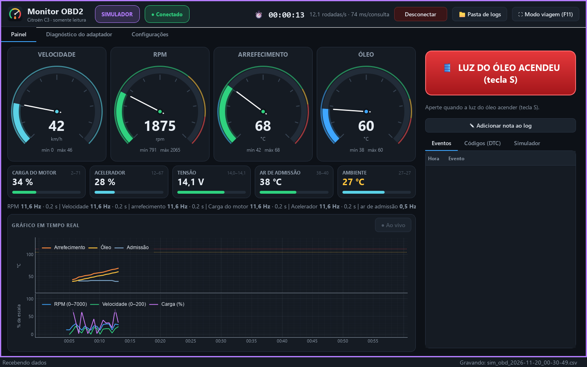
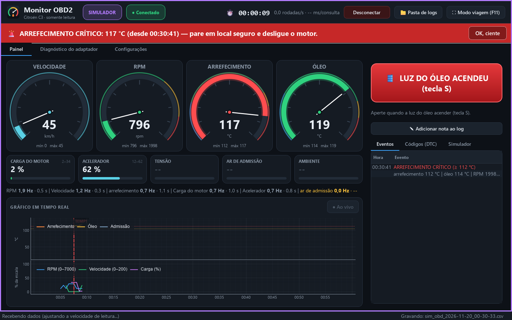
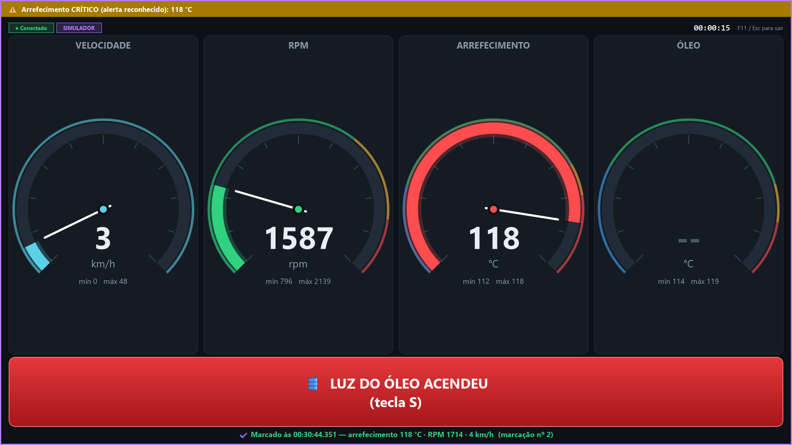
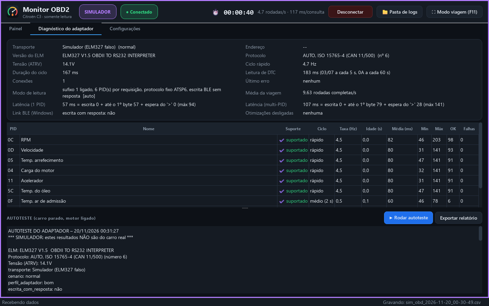
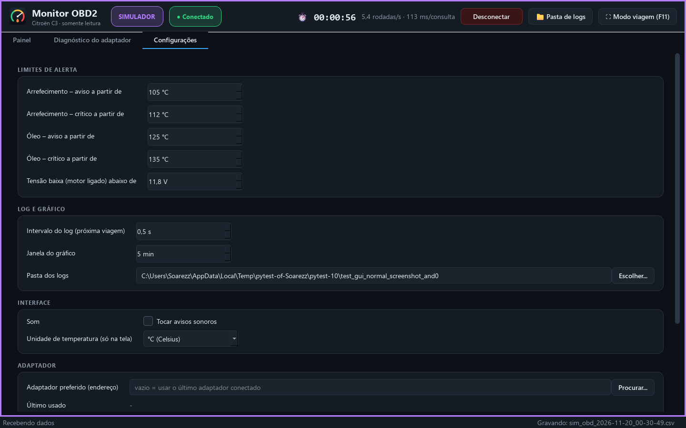
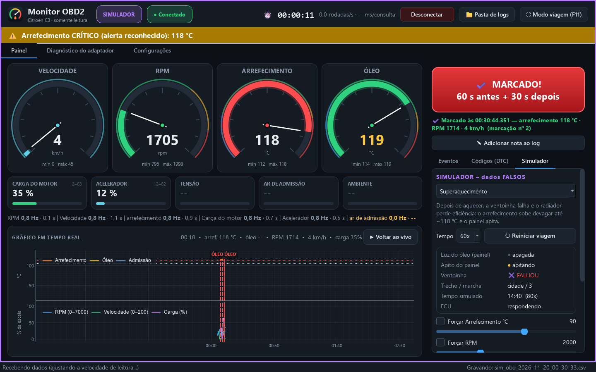

# Monitor OBD2 – Citroën C3 (somente leitura)

Programa para Windows 10/11 que lê o carro por um adaptador **ELM327 Bluetooth LE**, mostra tudo num
painel escuro e legível, **grava log automático** de cada viagem e traz um **simulador de carro** para
testar tudo sem o veículo.

Objetivo: descobrir **o momento exato** em que a luz do óleo acende e o que estava diferente naquela
hora (marcha lenta, aceleração/desaceleração, temperatura, carga, tensão).



---

## 1. Instalação e uso

Dê dois cliques em **`iniciar.bat`** (ou rode pelo terminal). Ele faz tudo sozinho:

1. procura o Python 3.10–3.13 (se não achar, instala o 3.12 com `winget install Python.Python.3.12`);
2. cria o ambiente virtual (veja abaixo onde);
3. instala as dependências (só na primeira vez ou quando o `requirements.txt` mudar);
4. abre o programa.

| Comando | O que faz |
|---|---|
| `iniciar.bat` | Carro real (Bluetooth LE). Na primeira vez abre a lista de adaptadores. |
| `iniciar.bat --sim` | **Simulador**, sem carro e sem adaptador. |
| `iniciar.bat --sim --cenario superaquecimento --fator 10` | Simulador com um cenário e tempo 10× mais rápido. |
| `iniciar.bat --benchmark` | **Benchmark de velocidade** (carro PARADO, motor ligado): escolhe e salva a forma mais rápida de ler. |
| `iniciar.bat --benchmark --sim` | Benchmark contra o simulador (`--perfil-adaptador clone_ruim` para um clone ruim). |
| `iniciar.bat --selftest` | **Autoteste** no console (carro parado, motor ligado). |
| `iniciar.bat --selftest --sim` | Autoteste contra o simulador. |
| `iniciar.bat --endereco AA:BB:CC:DD:EE:FF` | Força um adaptador específico. |
| `iniciar.bat --listar` | Só lista os dispositivos BLE próximos. |

**Onde fica o ambiente do Python:** em `%LOCALAPPDATA%\obd-monitor\venv`, fora do OneDrive (para não
sincronizar centenas de MB). Se esse disco tiver menos de 2 GB livres, o `iniciar.bat` usa a unidade com
mais espaço. A escolha fica gravada em `venv_local.txt`; apague esse arquivo para escolher de novo.
Neste notebook ele aponta para `D:\obd-monitor-venv-app`, porque o C: estava quase cheio.

### Antes de ir para o carro
- **Feche o app do celular** (Car Scanner): o adaptador só aceita uma conexão por vez.
- Bluetooth do notebook ligado. **Não é preciso parear** no Windows: o programa conecta direto por BLE.
- Ignição ligada (o adaptador costuma ficar sempre energizado, mas a ECU só responde com ignição).

---

## 2. Primeiro passo no carro: `iniciar.bat --benchmark` com o carro parado

Com o **carro parado e o motor ligado** (app do celular fechado), rode **`iniciar.bat --benchmark`**.
Leva 2 a 3 minutos. Ele testa, por ~15 s cada, várias formas de ler a rodada rápida (RPM, velocidade,
arrefecimento, carga, acelerador):

| Comb. | O que testa |
|---|---|
| A | um PID por vez, sem sufixo, escrita BLE com resposta: **modo seguro** (como o programa era antes) |
| A2 | igual, com escrita BLE **sem** resposta |
| B / B2 | um PID por vez **com o sufixo "1"** (`010C1`: o ELM327 responde sem esperar outras ECUs) |
| C1–C3 | B + `ATAT2`, `ATAT1 + ATST19`, `ATAT2 + ATST19` (timeout menor) |
| D2, D3, D5 | **vários PIDs numa requisição** (`010C0D1`, `010C0D051`, `010C0D0504111`), com e sem sufixo |

Para cada uma mede **rodadas completas por segundo**, latência média/máxima, **taxa de erros** (`?`,
`NO DATA`, `TIMEOUT`, resposta truncada/incompleta/trocada, valor fora da faixa física) e, a cada 1 s,
**confere os valores com a leitura individual**. Escolhe a mais rápida com **0% de erros**, salva no
`config.json` **para aquele adaptador** (pelo endereço Bluetooth) e usa sozinha nas próximas conexões.
O relatório fica em `logs/benchmark_<data>.txt`, por exemplo:

```
ESCOLHIDA: D5 – 5 PIDs por requisição com sufixo
Ganho: de 1,3 para 7,8 rodadas/s (6,0x) na rodada rápida.
```

Para refazer depois: **Configurações → Velocidade de leitura → Refazer benchmark** (com o programa
conectado, carro parado) ou `iniciar.bat --benchmark` de novo. "Esquecer benchmark deste adaptador"
volta à detecção automática.

> Sem benchmark o programa já funciona: ao conectar ele **detecta sozinho** o sufixo e o multi-PID
> (comparando com leituras individuais) e fixa o protocolo. O ATAT/ATST, porém, **só** é mudado com
> valores medidos pelo benchmark, nunca no escuro.

### Autoteste

Com o **motor ligado e o carro parado**, rode `iniciar.bat --selftest` (ou, na GUI, aba
**Diagnóstico do adaptador → Rodar autoteste**). Ele:

1. escaneia, conecta e inicializa o adaptador (`ATZ, ATE0, ATL0, ATS0, ATH0, ATSP0`, `0100`);
2. lista os PIDs que o carro anuncia e mede cada um 10 vezes (média/mín/máx/falhas);
3. lê os DTCs nos modos 03, 07 e 0A e mede quanto isso pesa no ciclo;
4. calcula a taxa real possível e quais PIDs cabem no ciclo rápido;
5. mostra um veredito em português (ex.: *"PID 5C (temperatura do óleo) NÃO suportado"*,
   *"Ciclo rápido: 2,8 Hz"*);
6. salva `logs/selftest_<data>.txt` (o último relatório aparece também na aba Diagnóstico).

Mande esse arquivo se algo não funcionar: ele diz exatamente o que o seu C3 responde.

---

## 3. A interface



- **Topo:** badge de conexão (verde *Conectado* / amarelo *Instável* / vermelho *Sem conexão* /
  roxo *SIMULADOR*), cronômetro da viagem, **rodadas rápidas completas por segundo** e latência média por
  requisição, Conectar, Pasta de logs, Modo viagem.
- **Taxa e idade de cada parâmetro** (linha abaixo das barras): `RPM 8,9 Hz · 0,1 s`. Hz = leituras
  válidas por segundo nos últimos 5 s; o segundo número é a **idade** do último valor. **Qualquer valor com
  mais de 1,5 s fica amarelo**, tanto nessa linha quanto no número do medidor. Na tela, um valor rápido
  continua visível (amarelo) até 5 s; no CSV ele some depois de 1,5 s.
- **Medidores:** velocidade, RPM, arrefecimento e óleo. As cores seguem as faixas: azul = frio,
  verde = normal, amarelo = atenção, vermelho = crítico. Cada medidor mostra o mín/máx da viagem.
  Se o carro não suportar o PID, o medidor fica **cinza com "não suportado pelo carro"**, sem valor inventado.
- **Barras:** carga, acelerador, tensão, ar de admissão, ambiente.
- **Gráfico (últimos 5 min, configurável):** temperaturas em °C (com as linhas de aviso e crítico) e motor
  (RPM, velocidade e carga em % da escala). Os eventos aparecem como **linhas verticais**: passe o mouse
  para ver os valores daquele instante. Arrastar ou dar zoom pausa o "ao vivo".
- **Botão vermelho "🛢 LUZ DO ÓLEO ACENDEU"** ou **tecla S** (funciona com o foco em qualquer lugar,
  exceto dentro de campos de texto). Ao acionar: bip, confirmação com horário e temperatura, evento no
  log e instantâneo de 60 s antes + 30 s depois.
- **Eventos:** lista com hora, tipo e valores. Clicar centraliza o gráfico naquele momento.
- **Códigos (DTC):** confirmados/pendentes/permanentes, com descrição em português e hora da primeira aparição.
- **Alertas:** faixa no topo + som. O alerta **crítico** fica na tela até você clicar em **OK** e repete o
  bip a cada ~5 s enquanto continuar crítico.
- **Modo viagem (F11):** só os 4 medidores grandes e o botão do óleo, em tela cheia. F11 ou Esc para sair.



| Diagnóstico do adaptador | Configurações |
|---|---|
|  |  |

**Configurações:** limites de alerta (padrão: arrefecimento 105/112 °C, óleo 125/135 °C, tensão < 11,8 V
com motor ligado), intervalo do log, janela do gráfico, som, unidade (°C/°F, só na tela), adaptador
preferido, pasta dos logs e **Velocidade de leitura** (liga/desliga as otimizações, mostra o benchmark
salvo, *Refazer benchmark*, *Esquecer benchmark*). Tudo fica salvo em `config.json`.

**Diagnóstico do adaptador:** além do que já mostrava, traz o **modo de leitura em uso** (ex.: *sufixo 1
ligado, 5 PID(s) por requisição, protocolo fixo ATSP6, escrita BLE sem resposta*), a **latência separada
em partes** (escrita + até o 1º byte + espera do `>`), a média da viagem, o intervalo de conexão BLE que o
Windows informou, as otimizações desligadas (com o motivo) e, por PID, **taxa (Hz) e idade**.

---

## 4. Os logs (a parte mais importante)

Ficam em `logs/` ao lado do programa. **Arquivos do simulador começam com `sim_`.**

| Arquivo | Conteúdo |
|---|---|
| `obd_AAAA-MM-DD_HH-MM-SS.csv` | **Uma linha a cada 0,5 s** durante a viagem inteira |
| `leituras_<viagem>.csv` | **Formato longo: uma linha por leitura real**, com o instante em que a resposta chegou (ms) |
| `eventos_<viagem>.log` | Uma linha legível por evento |
| `resumo_<viagem>.txt` | Duração, mín/máx/média de cada parâmetro, nº de eventos, linha do tempo, **taxa média da viagem e latência** |
| `eventos/evento_<data-hora>_<tipo>.csv` | **Instantâneo**: 60 s antes + 30 s depois do evento |
| `selftest_<data>.txt` | Resultado do autoteste |
| `benchmark_<data>.txt` | Resultado do benchmark de velocidade |
| `programa.log` | Log técnico. A cada 30 s grava taxa, latência por parte e modo de leitura |

### CSV da viagem
- Separador `;`, codificação `utf-8-sig` e **vírgula decimal**: abre direto no Excel brasileiro (duplo clique).
- Colunas: `data_hora` (ISO com milissegundos), `t_s` (segundos desde o início), `velocidade_kmh`, `rpm`,
  `arrefecimento_c`, `oleo_c`, `carga_pct`, `acelerador_pct`, `admissao_c`, `tensao_v`, `ambiente_c`,
  `dtcs_ativos`, `evento`, `nota` e, no fim, **`idade_ms_rpm`, `idade_ms_velocidade_kmh`,
  `idade_ms_arrefecimento_c`, `idade_ms_carga_pct`, `idade_ms_acelerador_pct`**.
- **`idade_ms_<param>`** = quanto tempo (ms) aquele valor tinha quando a linha foi escrita, contado a partir
  da chegada da resposta do carro. Ex.: `rpm = 812` com `idade_ms_rpm = 140` → o carro informou 812 rpm
  140 ms antes do `data_hora` da linha. Vazia quando o valor está vazio.
- **Valores repetidos são o último dado válido**: a linha de 0,5 s é uma "foto" dos valores mais recentes.
  Se o mesmo número aparece em duas linhas seguidas, ou o valor não mudou, ou ainda não chegou leitura nova
  (a idade mostra qual dos dois). Para saber exatamente quando cada valor foi lido, use o `leituras_*.csv`.
- **Cada linha recebe flush e fsync:** se o notebook desligar ou o programa travar, o que já foi gravado
  está no disco. A gravação roda numa thread separada e nunca atrasa a leitura do carro.
- **Célula vazia** = sem dado válido naquele momento (PID falhou, não suportado ou sem conexão).
- **Valores repetidos (por decisão de projeto):** PIDs de ciclo médio/lento repetem o último valor conhecido
  nas linhas intermediárias, até uma "validade":

  | Ciclo | PIDs | Consulta | Repetido por até |
  |---|---|---|---|
  | rápido | RPM, velocidade, arrefecimento, carga, acelerador, óleo | toda rodada | 1,5 s |
  | rebaixado | rápidos que não couberam em 0,5 s | 1 s | 3 s |
  | médio | ar de admissão, tensão | 2 s | 6 s |
  | lento | ambiente | 30 s | 90 s |

  Sem conexão, **todas** as colunas de valores ficam vazias.
- **Coluna `evento`** (vários no mesmo instante são separados por `|`): `INICIO_VIAGEM`, `FIM_VIAGEM`,
  `LUZ_OLEO_MANUAL`, `DTC_NOVO:P0xxx`, `DTC_APAGADO:P0xxx`, `ALERTA_ARREFECIMENTO_ALTO`,
  `ALERTA_ARREFECIMENTO_CRITICO`, `ALERTA_OLEO_QUENTE`, `ALERTA_TENSAO_BAIXA`, `CONEXAO_PERDIDA`,
  `CONEXAO_RESTABELECIDA`, `PID_NAO_SUPORTADO:xx`, `OTIMIZACAO_DESATIVADA:<qual>`.
- **Instantâneos** são criados para `LUZ_OLEO_MANUAL`, `DTC_NOVO` e alertas **críticos**
  (`ALERTA_ARREFECIMENTO_CRITICO` e `ALERTA_OLEO_QUENTE` no nível crítico).
- **Tecla S com milissegundos:** o instante gravado é o **do aperto**, não o do tique seguinte do log. Ele
  aparece no `eventos_*.log` (`21:16:11.234  LUZ DO ÓLEO ACENDEU ...`), na coluna `nota` da linha
  (`tecla S às 21:16:11.234`) e como uma linha `pid = S` no `leituras_*.csv`.

### Log longo `leituras_<viagem>.csv` (a base para analisar a queda de pressão)
- Colunas: `data_hora` (ms), `pid` (ex.: `0C`), `nome`, `valor`, `latencia_ms`.
- **Uma linha por leitura que realmente chegou do carro**, sem repetir valores nem preencher buracos.
  Se em 1 s chegaram 9 leituras de RPM, há 9 linhas de RPM.
- `data_hora` é o **instante em que a resposta chegou** ao notebook (1º byte da resposta), num relógio
  ancorado no início da viagem: não pula se o Windows acertar a hora no meio. O valor foi medido pela ECU
  um pouco antes (≈ metade da latência). `latencia_ms` é do envio do comando até o `>`.
- Pressionar **S** também gera uma linha (`pid = S`, `nome = LUZ_OLEO_MANUAL (tecla S)`).
- Gravado em lote (flush/fsync a cada 0,5 s) para não pesar no disco.
- No Excel: filtre `pid = 0C` e faça um gráfico de dispersão `data_hora` × `valor`. Para o momento da luz,
  procure a linha `S` e olhe as leituras dos segundos anteriores.

### Como investigar a luz do óleo
1. Sempre que a luz acender, **aperte S** (ou o botão vermelho).
2. Em casa, abra `logs/eventos/evento_..._LUZ_OLEO_MANUAL.csv` no Excel e faça um gráfico de
   linhas com `t_s` no eixo X e `arrefecimento_c`, `rpm`, `velocidade_kmh` e `carga_pct`.
3. Compare vários eventos: a luz acende sempre em **marcha lenta quente**? Sempre depois de
   **desacelerar**? Sempre acima de X °C? Com a **tensão** baixa?
4. O `eventos_<viagem>.log` dá a visão rápida, por exemplo:
   `17:30:12  LUZ DO ÓLEO ACENDEU | arrefecimento 104 °C | RPM 2300 | 60 km/h | carga 45% | acelerador 22%`

---

## 5. Limitações (leia!)

- **A luz de pressão do óleo do C3 provavelmente não aparece no OBD2 genérico.** Na PSA, o pressostato
  de óleo costuma ser lido pelo painel/BSI, não pela ECU do motor pelos modos padrão. Pode ser que
  **nenhum DTC apareça** quando a luz acende. Por isso o **botão S + log contínuo** é a ferramenta principal.
- **A temperatura do óleo (PID 5C) provavelmente não é suportada** pelo C3. Nesse caso o medidor fica cinza
  e a coluna `oleo_c` vazia. **O programa nunca inventa nem simula dados no modo real.**
- Ler dados específicos da PSA (UDS, serviço 22) ficou como **ponto de extensão** (`src/obdmon/ext/`),
  **não implementado**.
- A velocidade real depende do adaptador e do Windows (veja a seção 7). No modo seguro, um BLE barato
  faz ~1,3 rodadas/s. Com as otimizações, o simulador chega a ~9–13 rodadas/s; **no carro, só o benchmark
  diz quanto dá**.
- Pedir vários PIDs num comando (`010C0D05...`) e o sufixo `1` dependem do clone. Por isso tudo é
  detectado na conexão, conferido contra a leitura individual e desligado sozinho se der dado errado.
- O CSV fica na pasta do programa, que está dentro do **OneDrive**: ele vai sincronizar os logs, o que é
  normal. Se preferir, mude a pasta em Configurações.

### Segurança: somente leitura
O programa **só lê**. Uma whitelist (`src/obdmon/safety.py`) libera apenas `AT` de configuração do
próprio adaptador, modo `01` (dados), `03`/`07`/`0A` (leitura de DTC) e `09` (informações do veículo).
Para a velocidade, ela libera **exatamente**:
- modo `01` com **1 a 6 PIDs** na mesma requisição, sem PID repetido (`010C0D0504`);
- o **sufixo de respostas esperadas** (um dígito 1–9 no fim), **só no modo 01** (`010C1`, `010C0D051`);
- `ATAT0/1/2`, `ATST<hh>`, `ATSP<n>`, `ATDP`/`ATDPN`, `ATCAF0/1`.

**Todo o resto é bloqueado no código**, inclusive o modo `04` (apagar códigos, com ou sem sufixo), `2E`,
`2F`, `31`, `14`, `11`, `27`, `ATPP`, `ATSH`, `ATMA`, `ATMR`, `ATCRA`, 7+ PIDs e o sufixo em qualquer outro
modo (`031`, `040C1`...). A checagem acontece em duas camadas (protocolo e transporte). Há testes
automáticos que tentam enviar cada comando proibido e provam que nada chega ao adaptador, e outros que
provam que os comandos permitidos passam.

---

## 6. Simulador

`iniciar.bat --sim` roda o programa inteiro **sem carro**. O transporte simulado é um **ELM327 falso em
nível de bytes**: ele recebe `ATZ\r`, `010C\r`, `03\r`... e responde como o real (`41 0C 1A F8 \r\r>`,
`SEARCHING...`, `NO DATA`, `UNABLE TO CONNECT`, eco com `ATE1`, CAN multi-frame), em pedaços de ~20 bytes
e com atrasos, como no BLE. Por trás dele roda um modelo de carro: aquecimento, termostato, ventoinha
a ~97 °C, marchas, cidade/estrada, freio motor, tensão etc.

A janela ganha **borda roxa e badge "SIMULADOR"**, e os arquivos ganham o prefixo `sim_`, para ninguém
confundir dados falsos com reais.

**Modelo de latência** (para as otimizações serem testáveis): o rádio BLE leva 12–30 ms; a escrita **com
resposta** custa mais 15–40 ms (confirmação); a ECU responde em 10–20 ms. Sem o sufixo, o ELM falso
**espera o timeout** antes do `>` (ATAT1 ≈ 4× a resposta + 40 ms, ATAT2 ≈ 2× + 15 ms, ATAT0 = ATST
inteiro, padrão 0x32 ≈ 200 ms). Com o sufixo, devolve o `>` na hora. Um ATST menor que a resposta da ECU
dá `NO DATA`. Multi-PID responde numa linha (até 7 bytes) ou em multi-frame CAN. Nesse modelo, o modo
seguro dá ~0,7–0,9 rodadas/s, perto do que o C3 real mostrou (~1,3).

| Perfil do adaptador (`--perfil-adaptador`) | Comportamento |
|---|---|
| `bom` (padrão) | sufixo e multi-PID funcionam |
| `clone_ruim` | multi-PID devolve **só o 1º PID** e erra de vez em quando (`NO DATA` ocasional) |
| `clone_interrog` | responde `?` a qualquer multi-PID |
| `clone_instavel` | multi-PID passa na detecção e depois **às vezes vem incompleto** (testa o fallback em tempo real) |
| `sem_sufixo` | responde `?` ao sufixo (ELM antigo) |

| Cenário (`--cenario`) | O que acontece |
|---|---|
| `normal` | Viagem tranquila de ~15 min (lenta, cidade, estrada, cidade) |
| `superaquecimento` | Ventoinha falha, arrefecimento sobe devagar até ~118 °C, P0217 |
| `queda_pressao_oleo` | Em lenta quente, o óleo esquenta; P0521 (pendente) → P0524; depois somem |
| `intermitente` | A luz do óleo do painel simulado acende e apaga **sem DTC**: treine a tecla S |
| `bluetooth_instavel` | Quedas de 2–15 s, travadas silenciosas, perda de pacotes, respostas truncadas |
| `sem_oleo_pid` | O carro não suporta o PID 5C (como o C3 real provavelmente é) nem o 46 |
| `ecu_dormindo` | `UNABLE TO CONNECT` nos primeiros 20 s (ignição desligada), depois conecta |
| `dtc_variados` | Vários códigos aparecendo e sumindo (pendente → confirmado → apagado) |

**Painel do simulador** (aba "Simulador", à direita): troca de cenário, velocidade do tempo (1× a 60×),
estado do painel simulado (luz do óleo, apito, ventoinha), sliders para forçar arrefecimento/RPM/velocidade
e os botões *Superaquecer agora*, *Injetar DTC…*, *Derrubar conexão 10 s*, *Acender luz do óleo* e *Restaurar*.



---

## 7. Conexão robusta e decisões técnicas

- **Watchdog:** 3 s sem dado válido → badge amarelo *Instável*; 8 s → *conexão perdida*.
- **Perdeu a conexão:** o log continua (linhas vazias + `CONEXAO_PERDIDA`), aparece uma faixa vermelha com
  o tempo sem dados, toca um aviso e o programa **reconecta sozinho** com espera crescente
  (1 s, 2 s, 5 s, 10 s e depois a cada 10 s). Ao voltar: `CONEXAO_RESTABELECIDA`, o ELM é reinicializado
  (`ATZ`...), e a lista de PIDs **não** é redescoberta (já é conhecida).
- **Ignição desligada** (`UNABLE TO CONNECT`): o programa mantém o Bluetooth e tenta o `0100` a cada 3 s.
- **Suporte de PIDs:** descoberto com `0100/0120/0140/0160` (unindo as máscaras de todas as ECUs que
  responderem). PID que a máscara diz não existir **nunca é consultado**. PID que responde `NO DATA` 5
  vezes seguidas (com os outros respondendo) vira "não suportado" e é retestado só a cada 60 s.
- **Escalonador:** **RPM → velocidade → arrefecimento → carga → acelerador** ficam **sempre** no ciclo
  rápido. O óleo (5C) entra também se o carro tiver e couber em 85% de 0,5 s (senão vai para 1 s,
  "rebaixado"). Ar de admissão e tensão a cada 2 s, ambiente a cada 30 s. Com multi-PID, a rodada rápida
  inteira pode ser **uma requisição só** (`010C0D0504111`). **Depois** de cada rodada rápida completa roda no
  máximo 1 tarefa extra (PID lento ou DTC), ou 2 se houver fila. **A leitura de DTC nunca entra no meio de
  uma rodada rápida.**
- **O poller não espera o log:** ele emenda uma rodada na outra, sem pausas artificiais. O tique de 0,5 s
  do log só tira uma "foto" dos últimos valores; os dois rodam em tarefas separadas.
- **Otimizações e fallback:** ao conectar, o programa fixa o protocolo (`ATDPN` → `ATSP6`), testa o sufixo
  (`010C1`, 3 vezes, comparando com a leitura normal) e o multi-PID (primeiro 2 PIDs; se passar, o maior
  grupo que vier completo e igual à leitura individual, 2 vezes seguidas). Com benchmark salvo, usa o
  resultado dele e só confere. Se durante a viagem uma otimização der `?`, resposta incompleta/truncada,
  PID trocado ou valor fora da faixa física, **só aquela otimização é desligada** até o fim da sessão. Os
  mesmos PIDs são relidos um por um na mesma rodada (nada se perde), e isso fica registrado no `programa.log`,
  no CSV (`OTIMIZACAO_DESATIVADA:<qual>`), no resumo e na barra de status. Protocolo fixo que não responder
  volta para o automático. Se a escrita sem resposta não funcionar, volta para "com resposta".
- **DTC:** modos 03 e 07 a cada ~5 s, 0A a cada 60 s. `DTC_NOVO` quando um código aparece em qualquer modo
  (passar de pendente para confirmado não conta como novo). `DTC_APAGADO` só depois de 2 leituras seguidas
  sem ele, para respostas truncadas não gerarem alarme falso.
- **Arquitetura:** o núcleo (`asyncio`) roda numa thread dedicada. É o jeito recomendado de usar o `bleak`
  no Windows junto com uma GUI Qt, e a interface nunca trava esperando o Bluetooth. A GUI é PySide6 +
  pyqtgraph, com medidores desenhados em QPainter e ponteiros animados a 60 fps.

---

### Por que a taxa "variava" entre viagens (diagnóstico dos logs de 19/11)

Os resumos das 4 viagens mostravam 1,3 / 4,4 / 1,2 / 4,3 Hz. **A leitura não variou; o número do resumo
é que estava errado.** Ele gravava a taxa **dos últimos 5 s antes de fechar o programa**, quando o motor
já tinha sido desligado (linhas finais vazias). Medindo pelos próprios CSVs, a fração de linhas sem
nenhum valor novo de RPM/carga/acelerador é **igual nas 4 viagens (22–25%)**, o que corresponde a
~1,3 rodadas/s em todas. Agora o resumo traz a **média da viagem** (rodadas completas ÷ tempo lendo),
a taxa de cada parâmetro e a latência separada em partes.

Por que ~1,3 rodadas/s (≈ 150–200 ms por PID) no modo antigo:
1. **O ELM327 esperava o timeout depois de cada resposta** (padrão ≈ 200 ms, reduzido pelo ATAT1), para
   ver se outra ECU respondia. É a maior parte do tempo e o **sufixo "1"** elimina isso (código nosso:
   corrigido).
2. **Escrita BLE com resposta:** o programa usava "write with response" sempre que a característica
   permitia, e cada comando esperava a confirmação do rádio (1+ intervalo de conexão). Agora usa
   "write without response" quando existe (código nosso: corrigido, com fallback).
3. **Uma requisição por PID:** 5 idas e voltas por rodada. Com multi-PID vira 1 (código nosso: corrigido,
   se o adaptador aceitar).
4. **Pausas:** havia um piso de 50 ms por rodada e 1 s fixo depois do `ATZ`. O piso saiu e a espera
   depois do `ATZ` caiu para 0,3 s quando o `>` chega (código nosso: corrigido). O tique de 0,5 s do log
   **não** segurava o poller (são tarefas separadas, e isso continua assim, agora com teste).

**Depende do Windows/adaptador (não dá para corrigir no programa, só medir):**
- **Intervalo de conexão BLE:** o Windows escolhe (tipicamente 7,5–50 ms, pode subir em economia de
  energia). O programa pede ao Windows o perfil "ThroughputOptimized" (Windows 11) e mostra o intervalo
  obtido na aba Diagnóstico e no `programa.log`. O Windows pode ignorar o pedido.
- **Economia de energia:** no carro, use o notebook **na tomada** (ou plano "Melhor desempenho") e, no
  Gerenciador de Dispositivos → adaptador Bluetooth → Gerenciamento de Energia, desmarque "Permitir que o
  computador desligue este dispositivo". Na bateria, o Windows pode alongar o intervalo de conexão.
- **O chip do adaptador (JL_SPP):** como ele junta os bytes da UART em notificações BLE, se aceita
  multi-PID e o sufixo e quanto a ECU do C3 demora. Só o benchmark no carro responde isso.

---

## 8. Solução de problemas

| Sintoma | O que fazer |
|---|---|
| Adaptador não aparece na lista | Feche o app do celular (Car Scanner), ligue a ignição, ligue o Bluetooth do notebook, marque "Mostrar todos os dispositivos". |
| "Não achei as características de comunicação" | Copie a lista de serviços que aparece no erro / `logs/programa.log` e mande para análise. |
| Badge amarelo "carro não responde" | Ignição desligada ou protocolo não detectado. Ligue a ignição e espere (a busca leva até 12 s). |
| Medidor cinza "não suportado" | O C3 não fornece esse dado pelo OBD2 genérico. É esperado para o óleo. |
| Taxa baixa (< 2 rodadas/s) | Rode `iniciar.bat --benchmark` parado. Veja na aba Diagnóstico o modo de leitura, a latência por parte (se a "espera do `>`" for grande, o sufixo não está ligado) e o intervalo BLE. Notebook na tomada. |
| "Otimização desativada" na barra de status | O adaptador deu uma resposta inválida com aquela otimização. O programa voltou ao modo seguro só para ela e seguiu gravando. Se acontecer sempre, refaça o benchmark. |
| Quero o comportamento antigo | Configurações → Velocidade de leitura → desmarque "Usar otimizações". |
| "ERRO AO GRAVAR O LOG" | Disco cheio? Mude a pasta dos logs em Configurações. |
| Quero reinstalar as dependências | Apague a pasta indicada em `venv_local.txt` (e o próprio arquivo) e rode o `iniciar.bat` de novo. |

---

## 9. O que foi testado e o que só dá para confirmar no carro

**Verificado aqui (Windows 11, Python 3.12, com o simulador):**
- `pytest`: parsing de todas as respostas e fórmulas (inclusive eco, `SEARCHING...`, `NO DATA`, linhas
  duplicadas, multi-frame fora de ordem, respostas truncadas), decodificação de DTC, whitelist (varredura
  dos 256 modos + injeção de `\r`), logger (0,5 s, flush por linha, instantâneo 60 s/30 s, arquivo novo por
  viagem), os 8 cenários de ponta a ponta com os eventos esperados, reconexão após derrubar o transporte,
  travada silenciosa → watchdog, autoteste, e um smoke test da GUI (offscreen) que roda o superaquecimento,
  confere o alerta, aperta a tecla S e o botão, e gera as capturas desta página.
- `iniciar.bat` num **ambiente virtual novo e vazio** neste notebook: criou o venv, instalou só o
  `requirements.txt`, abriu a GUI real em `--sim` e fechou sem erros. Também rodou `--selftest --sim`.
  **Não foi testado:** um Windows recém-instalado sem Python. O ramo que instala o Python via `winget` não
  foi exercitado, porque este notebook já tinha Python.

**Velocidade de leitura: verificado SÓ no simulador** (`tests/test_speed.py`, `tests/test_safety.py`):
- parsing multi-PID (uma linha, multi-frame CAN, fora de ordem, com/sem espaços) e detecção de resposta
  incompleta, truncada, com PID trocado, `?` e `NO DATA`;
- **critério de aceite:** no modelo de latência do simulador, a rodada rápida ficou **≥ 3x mais rápida**
  com as otimizações do que no modo seguro (medido: ~0,7 → ~9 rodadas/s), sem aumento de erros;
- o benchmark escolhe a combinação mais rápida com 0% de erros, calcula o ganho, salva por adaptador e o
  valor salvo é usado na conexão seguinte;
- perfis "clone ruim": o programa detecta na conexão que o multi-PID não funciona (só o 1º PID / `?`), ou
  desliga o agrupamento **em tempo de execução** quando ele começa a falhar, e o log de 0,5 s continua
  sem buracos;
- log longo: uma linha por leitura real, com ms, e a coluna `idade_ms_*` bate com o instante real da
  leitura (±3 ms); tecla S com o instante do aperto em ms;
- whitelist: os novos comandos passam e os proibidos (modo 04 com sufixo, 7 PIDs, sufixo fora do modo 01,
  ATPP/ATSH/ATMA...) continuam bloqueados; reconexão e watchdog continuam funcionando com as otimizações.

**Só dá para confirmar no carro (nada disso foi testado com hardware real):**
- **o ganho real de velocidade** com o seu adaptador "OBDII" (JL_SPP) e o C3;
- **se o adaptador aceita multi-PID** e com quantos PIDs, **se aceita o sufixo "1"** (inclusive em
  respostas multi-frame) e se a escrita BLE sem resposta é confiável nele;
- qual ATAT/ATST a ECU do C3 tolera sem `NO DATA`;
- o intervalo de conexão BLE que o Windows dá a ele (e se atende o pedido "ThroughputOptimized");
- conexão BLE: serviço/características e se as notificações chegam;
- formato real das respostas de DTC do C3 e se algum código aparece quando a luz acende;
- comportamento ao desligar/ligar a ignição com o adaptador conectado.

Ordem sugerida: **(1) `iniciar.bat --benchmark` com o carro PARADO e o motor ligado** (mande o
`logs/benchmark_<data>.txt` se quiser conferir); **(2)** `iniciar.bat --selftest`, também parado;
**(3)** `iniciar.bat`, uns minutos parado, para ver os medidores e a taxa por parâmetro; **(4)** dirigir com
o notebook **na tomada** e em modo viagem (F11), apertando **S** quando a luz acender.

---

## 10. Para desenvolvedores

```
obd-monitor/
  iniciar.bat  requirements.txt  requirements-dev.txt  pytest.ini  README.md
  src/obdmon/
    app.py            entrada (--sim, --cenario, --fator, --perfil-adaptador, --selftest, --benchmark,
                      --benchmark-s, --endereco, --listar)
    safety.py         whitelist (somente leitura)
    elm.py            protocolo ELM327: fila de comandos, parsing (multi-PID), tempos por parte, Tuning
    pids.py  dtc.py   tabela de PIDs/fórmulas/faixas físicas; DTC + descrições em português
    poller.py         escalonador, otimizações com detecção/fallback, DTC, watchdog, reconexão
    benchmark.py      autobenchmark de velocidade
    events.py         eventos, alertas (histerese), buffer circular
    logger.py         CSV por viagem, instantâneos, .log, resumo (thread própria)
    engine.py         orquestra tudo num tique de 0,5 s; thread do asyncio
    selftest.py       autoteste
    transport/        base.py  ble.py (bleak)  simulated.py
    sim/              car_model.py  scenarios.py  fake_elm.py
    ui/               main_window.py gauges.py charts.py events_panel.py dtc_panel.py
                      settings.py sim_panel.py diag_panel.py scan_dialog.py theme.py sound.py
    ext/              ponto de extensão PSA/UDS (não implementado)
  tests/
```

Rodar os testes (no ambiente do projeto, com `pip install -r requirements-dev.txt`):

```
set PYTHONPATH=src
python -m pytest
```
O `tests/conftest.py` já liga `QT_QPA_PLATFORM=offscreen`.
