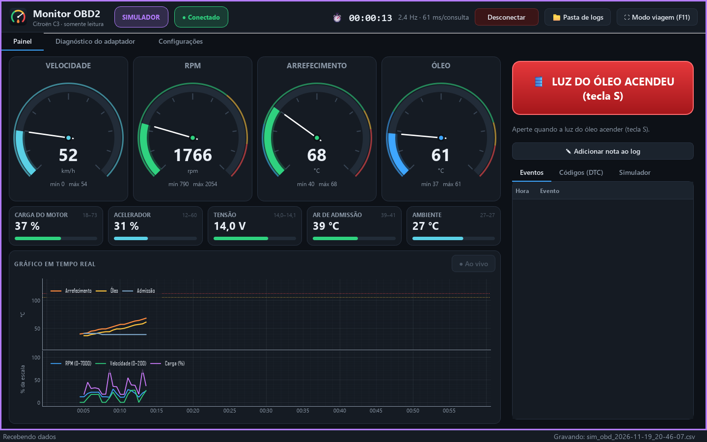
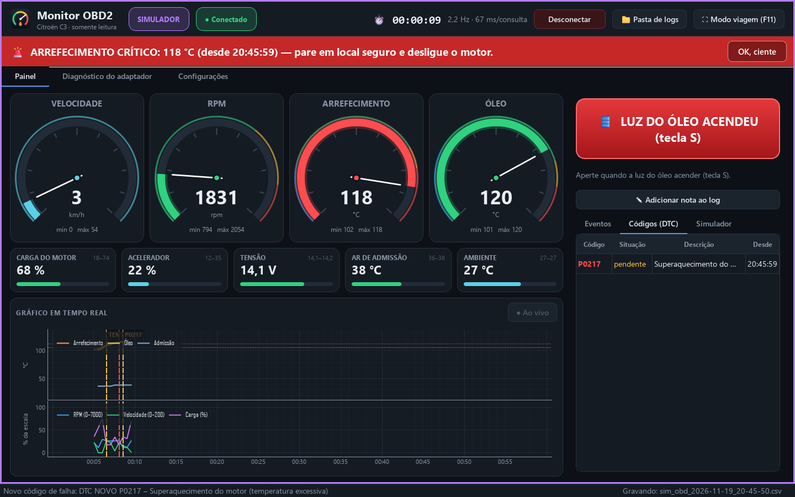
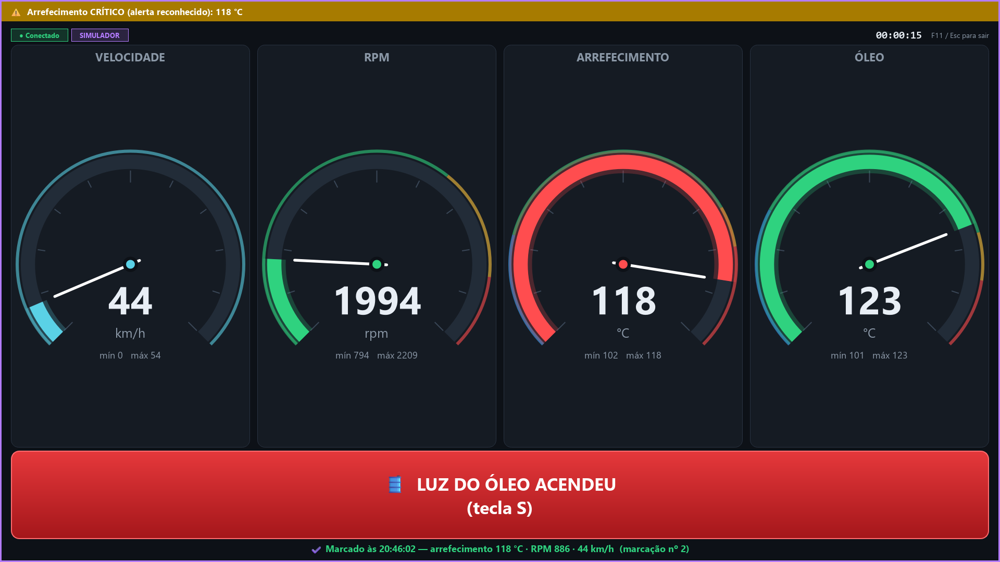
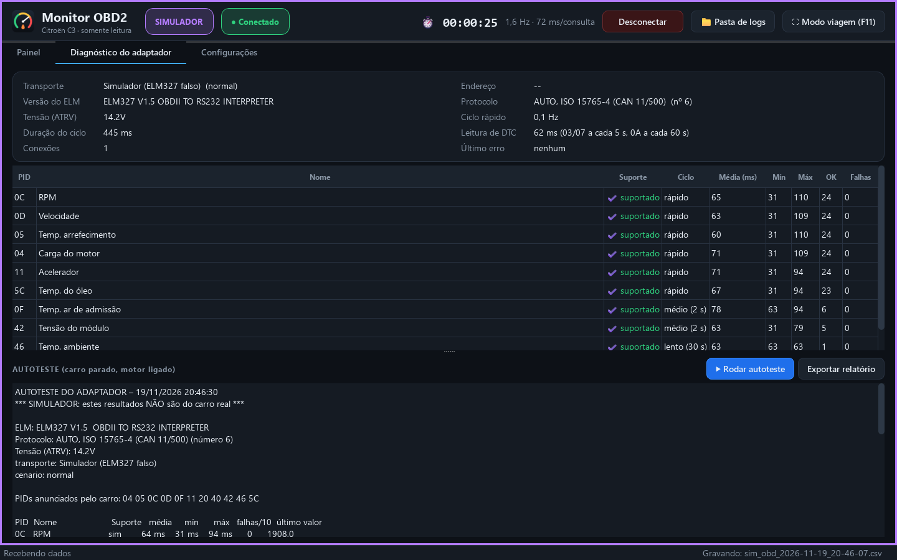
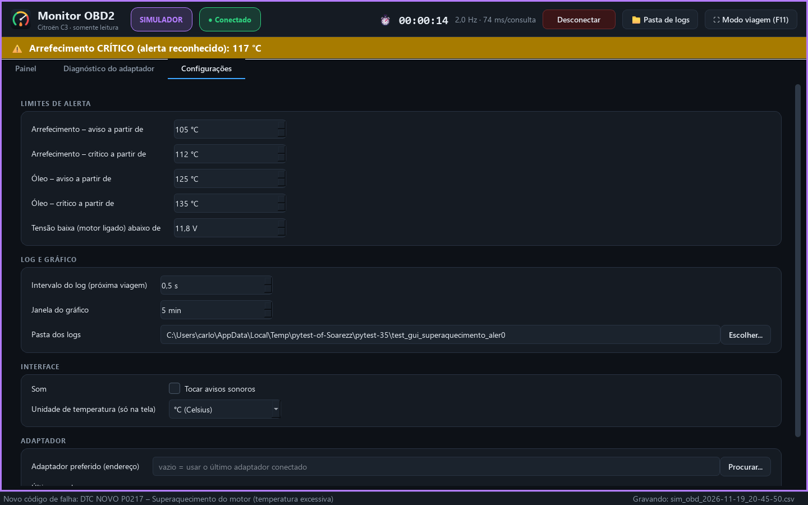
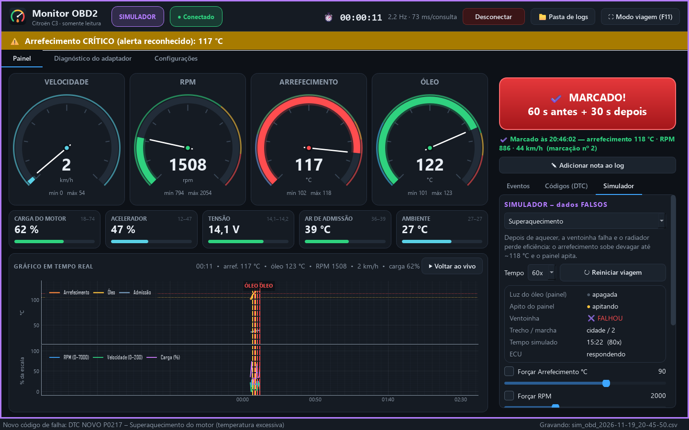

# Monitor OBD2 – Citroën C3 (somente leitura)

Programa para Windows 10/11 que lê o carro por um adaptador **ELM327 Bluetooth LE**, mostra tudo num
painel escuro e legível, **grava log automático** de cada viagem e traz um **simulador de carro** para
testar tudo sem o veículo.

Objetivo: descobrir **o momento exato** em que a luz do óleo acende e o que estava diferente naquela
hora (marcha lenta, aceleração/desaceleração, temperatura, carga, tensão).



---

## 1. Instalação e uso

Dê dois cliques em **`iniciar.bat`** (ou rode pelo terminal). Ele faz tudo sozinho:

1. procura o Python 3.10–3.13 (se não achar, instala o 3.12 com `winget install Python.Python.3.12`);
2. cria o ambiente virtual (veja abaixo onde);
3. instala as dependências (só na primeira vez ou quando o `requirements.txt` mudar);
4. abre o programa.

| Comando | O que faz |
|---|---|
| `iniciar.bat` | Carro real (Bluetooth LE). Na primeira vez abre a lista de adaptadores. |
| `iniciar.bat --sim` | **Simulador**, sem carro e sem adaptador. |
| `iniciar.bat --sim --cenario superaquecimento --fator 10` | Simulador com um cenário e tempo 10× mais rápido. |
| `iniciar.bat --selftest` | **Autoteste** no console (carro parado, motor ligado). |
| `iniciar.bat --selftest --sim` | Autoteste contra o simulador. |
| `iniciar.bat --endereco AA:BB:CC:DD:EE:FF` | Força um adaptador específico. |
| `iniciar.bat --listar` | Só lista os dispositivos BLE próximos. |

**Onde fica o ambiente do Python:** em `%LOCALAPPDATA%\obd-monitor\venv`, fora do OneDrive (para não
sincronizar centenas de MB). Se esse disco tiver menos de 2 GB livres, o `iniciar.bat` usa a unidade com
mais espaço. A escolha fica gravada em `venv_local.txt`; apague esse arquivo para escolher de novo.
Neste notebook ele aponta para `D:\obd-monitor-venv-app`, porque o C: estava quase cheio.

### Antes de ir para o carro
- **Feche o app do celular** (Car Scanner): o adaptador só aceita uma conexão por vez.
- Bluetooth do notebook ligado. **Não é preciso parear** no Windows: o programa conecta direto por BLE.
- Ignição ligada (o adaptador costuma ficar sempre energizado, mas a ECU só responde com ignição).

---

## 2. Primeiro teste no carro: autoteste com o carro parado

Com o **motor ligado e o carro parado**, rode `iniciar.bat --selftest` (ou, na GUI, aba
**Diagnóstico do adaptador → Rodar autoteste**). Ele:

1. escaneia, conecta e inicializa o adaptador (`ATZ, ATE0, ATL0, ATS0, ATH0, ATSP0`, `0100`);
2. lista os PIDs que o carro anuncia e mede cada um 10 vezes (média/mín/máx/falhas);
3. lê os DTCs nos modos 03, 07 e 0A e mede quanto isso pesa no ciclo;
4. calcula a taxa real possível e quais PIDs cabem no ciclo rápido;
5. mostra um veredito em português (ex.: *"PID 5C (temperatura do óleo) NÃO suportado"*,
   *"Ciclo rápido: 2,8 Hz"*);
6. salva `logs/selftest_<data>.txt` (o último relatório aparece também na aba Diagnóstico).

Mande esse arquivo se algo não funcionar: ele diz exatamente o que o seu C3 responde.

---

## 3. A interface



- **Topo:** badge de conexão (verde *Conectado* / amarelo *Instável* / vermelho *Sem conexão* /
  roxo *SIMULADOR*), cronômetro da viagem, taxa real (Hz) e latência média por consulta, Conectar,
  Pasta de logs, Modo viagem.
- **Medidores:** velocidade, RPM, arrefecimento e óleo. As cores seguem as faixas: azul = frio,
  verde = normal, amarelo = atenção, vermelho = crítico. Cada medidor mostra o mín/máx da viagem.
  Se o carro não suportar o PID, o medidor fica **cinza com "não suportado pelo carro"**, sem valor inventado.
- **Barras:** carga, acelerador, tensão, ar de admissão, ambiente.
- **Gráfico (últimos 5 min, configurável):** temperaturas em °C (com as linhas de aviso e crítico) e motor
  (RPM, velocidade e carga em % da escala). Os eventos aparecem como **linhas verticais**: passe o mouse
  para ver os valores daquele instante. Arrastar ou dar zoom pausa o "ao vivo".
- **Botão vermelho "🛢 LUZ DO ÓLEO ACENDEU"** ou **tecla S** (funciona com o foco em qualquer lugar,
  exceto dentro de campos de texto). Ao acionar: bip, confirmação com horário e temperatura, evento no
  log e instantâneo de 60 s antes + 30 s depois.
- **Eventos:** lista com hora, tipo e valores. Clicar centraliza o gráfico naquele momento.
- **Códigos (DTC):** confirmados/pendentes/permanentes, com descrição em português e hora da primeira aparição.
- **Alertas:** faixa no topo + som. O alerta **crítico** fica na tela até você clicar em **OK** e repete o
  bip a cada ~5 s enquanto continuar crítico.
- **Modo viagem (F11):** só os 4 medidores grandes e o botão do óleo, em tela cheia. F11 ou Esc para sair.



| Diagnóstico do adaptador | Configurações |
|---|---|
|  |  |

**Configurações:** limites de alerta (padrão: arrefecimento 105/112 °C, óleo 125/135 °C, tensão < 11,8 V
com motor ligado), intervalo do log, janela do gráfico, som, unidade (°C/°F, só na tela), adaptador
preferido e pasta dos logs. Tudo fica salvo em `config.json`.

---

## 4. Os logs (a parte mais importante)

Ficam em `logs/` ao lado do programa. **Arquivos do simulador começam com `sim_`.**

| Arquivo | Conteúdo |
|---|---|
| `obd_AAAA-MM-DD_HH-MM-SS.csv` | **Uma linha a cada 0,5 s** durante a viagem inteira |
| `eventos_<viagem>.log` | Uma linha legível por evento |
| `resumo_<viagem>.txt` | Duração, mín/máx/média de cada parâmetro, nº de eventos, linha do tempo |
| `eventos/evento_<data-hora>_<tipo>.csv` | **Instantâneo**: 60 s antes + 30 s depois do evento |
| `selftest_<data>.txt` | Resultado do autoteste |
| `programa.log` | Log técnico (para solução de problemas) |

### CSV da viagem
- Separador `;`, codificação `utf-8-sig` e **vírgula decimal**: abre direto no Excel brasileiro (duplo clique).
- Colunas: `data_hora` (ISO com milissegundos), `t_s` (segundos desde o início), `velocidade_kmh`, `rpm`,
  `arrefecimento_c`, `oleo_c`, `carga_pct`, `acelerador_pct`, `admissao_c`, `tensao_v`, `ambiente_c`,
  `dtcs_ativos`, `evento`, `nota`.
- **Cada linha recebe flush e fsync:** se o notebook desligar ou o programa travar, o que já foi gravado
  está no disco. A gravação roda numa thread separada e nunca atrasa a leitura do carro.
- **Célula vazia** = sem dado válido naquele momento (PID falhou, não suportado ou sem conexão).
- **Valores repetidos (por decisão de projeto):** PIDs de ciclo médio/lento repetem o último valor conhecido
  nas linhas intermediárias, até uma "validade":

  | Ciclo | PIDs | Consulta | Repetido por até |
  |---|---|---|---|
  | rápido | RPM, velocidade, arrefecimento, carga, acelerador, óleo | toda rodada | 1,5 s |
  | rebaixado | rápidos que não couberam em 0,5 s | 1 s | 3 s |
  | médio | ar de admissão, tensão | 2 s | 6 s |
  | lento | ambiente | 30 s | 90 s |

  Sem conexão, **todas** as colunas de valores ficam vazias.
- **Coluna `evento`** (vários no mesmo instante são separados por `|`): `INICIO_VIAGEM`, `FIM_VIAGEM`,
  `LUZ_OLEO_MANUAL`, `DTC_NOVO:P0xxx`, `DTC_APAGADO:P0xxx`, `ALERTA_ARREFECIMENTO_ALTO`,
  `ALERTA_ARREFECIMENTO_CRITICO`, `ALERTA_OLEO_QUENTE`, `ALERTA_TENSAO_BAIXA`, `CONEXAO_PERDIDA`,
  `CONEXAO_RESTABELECIDA`, `PID_NAO_SUPORTADO:xx`.
- **Instantâneos** são criados para `LUZ_OLEO_MANUAL`, `DTC_NOVO` e alertas **críticos**
  (`ALERTA_ARREFECIMENTO_CRITICO` e `ALERTA_OLEO_QUENTE` no nível crítico).

### Como investigar a luz do óleo
1. Sempre que a luz acender, **aperte S** (ou o botão vermelho).
2. Em casa, abra `logs/eventos/evento_..._LUZ_OLEO_MANUAL.csv` no Excel e faça um gráfico de
   linhas com `t_s` no eixo X e `arrefecimento_c`, `rpm`, `velocidade_kmh` e `carga_pct`.
3. Compare vários eventos: a luz acende sempre em **marcha lenta quente**? Sempre depois de
   **desacelerar**? Sempre acima de X °C? Com a **tensão** baixa?
4. O `eventos_<viagem>.log` dá a visão rápida, por exemplo:
   `17:30:12  LUZ DO ÓLEO ACENDEU | arrefecimento 104 °C | RPM 2300 | 60 km/h | carga 45% | acelerador 22%`

---

## 5. Limitações (leia!)

- **A luz de pressão do óleo do C3 provavelmente não aparece no OBD2 genérico.** Na PSA, o pressostato
  de óleo costuma ser lido pelo painel/BSI, não pela ECU do motor pelos modos padrão. Pode ser que
  **nenhum DTC apareça** quando a luz acende. Por isso o **botão S + log contínuo** é a ferramenta principal.
- **A temperatura do óleo (PID 5C) provavelmente não é suportada** pelo C3. Nesse caso o medidor fica cinza
  e a coluna `oleo_c` vazia. **O programa nunca inventa nem simula dados no modo real.**
- Ler dados específicos da PSA (UDS, serviço 22) ficou como **ponto de extensão** (`src/obdmon/ext/`),
  **não implementado**.
- Adaptadores BLE baratos respondem em ~50–150 ms por consulta. Com 6 PIDs no ciclo rápido dá algo
  como 1,5–3 Hz. O log continua a cada 0,5 s, mas alguns valores serão repetidos (veja a tabela acima).
- Os PIDs são consultados um por vez. Pedir vários PIDs num só comando (`010C0D05...`) seria mais rápido
  em carros CAN, mas muitos clones não suportam isso. Não está implementado.
- O CSV fica na pasta do programa, que está dentro do **OneDrive**: ele vai sincronizar os logs, o que é
  normal. Se preferir, mude a pasta em Configurações.

### Segurança: somente leitura
O programa **só lê**. Uma whitelist (`src/obdmon/safety.py`) libera apenas `AT` de configuração do
próprio adaptador, modo `01` (dados), `03`/`07`/`0A` (leitura de DTC) e `09` (informações do veículo).
**Todo o resto é bloqueado no código**, inclusive o modo `04` (apagar códigos), `2E`, `2F`, `31`, `14`,
`11`, `27`, `ATPP`, `ATSH` e `ATMA`. A checagem acontece em duas camadas (protocolo e transporte).
Há testes automáticos que tentam enviar cada comando proibido e provam que nada chega ao adaptador.

---

## 6. Simulador

`iniciar.bat --sim` roda o programa inteiro **sem carro**. O transporte simulado é um **ELM327 falso em
nível de bytes**: ele recebe `ATZ\r`, `010C\r`, `03\r`... e responde como o real (`41 0C 1A F8 \r\r>`,
`SEARCHING...`, `NO DATA`, `UNABLE TO CONNECT`, eco com `ATE1`, CAN multi-frame), em pedaços de ~20 bytes
e com atrasos, como no BLE. Por trás dele roda um modelo de carro: aquecimento, termostato, ventoinha
a ~97 °C, marchas, cidade/estrada, freio motor, tensão etc.

A janela ganha **borda roxa e badge "SIMULADOR"**, e os arquivos ganham o prefixo `sim_`, para ninguém
confundir dados falsos com reais.

| Cenário (`--cenario`) | O que acontece |
|---|---|
| `normal` | Viagem tranquila de ~15 min (lenta, cidade, estrada, cidade) |
| `superaquecimento` | Ventoinha falha, arrefecimento sobe devagar até ~118 °C, P0217 |
| `queda_pressao_oleo` | Em lenta quente, o óleo esquenta; P0521 (pendente) → P0524; depois somem |
| `intermitente` | A luz do óleo do painel simulado acende e apaga **sem DTC**: treine a tecla S |
| `bluetooth_instavel` | Quedas de 2–15 s, travadas silenciosas, perda de pacotes, respostas truncadas |
| `sem_oleo_pid` | O carro não suporta o PID 5C (como o C3 real provavelmente é) nem o 46 |
| `ecu_dormindo` | `UNABLE TO CONNECT` nos primeiros 20 s (ignição desligada), depois conecta |
| `dtc_variados` | Vários códigos aparecendo e sumindo (pendente → confirmado → apagado) |

**Painel do simulador** (aba "Simulador", à direita): troca de cenário, velocidade do tempo (1× a 60×),
estado do painel simulado (luz do óleo, apito, ventoinha), sliders para forçar arrefecimento/RPM/velocidade
e os botões *Superaquecer agora*, *Injetar DTC…*, *Derrubar conexão 10 s*, *Acender luz do óleo* e *Restaurar*.



---

## 7. Conexão robusta e decisões técnicas

- **Watchdog:** 3 s sem dado válido → badge amarelo *Instável*; 8 s → *conexão perdida*.
- **Perdeu a conexão:** o log continua (linhas vazias + `CONEXAO_PERDIDA`), aparece uma faixa vermelha com
  o tempo sem dados, toca um aviso e o programa **reconecta sozinho** com espera crescente
  (1 s, 2 s, 5 s, 10 s e depois a cada 10 s). Ao voltar: `CONEXAO_RESTABELECIDA`, o ELM é reinicializado
  (`ATZ`...), e a lista de PIDs **não** é redescoberta (já é conhecida).
- **Ignição desligada** (`UNABLE TO CONNECT`): o programa mantém o Bluetooth e tenta o `0100` a cada 3 s.
- **Suporte de PIDs:** descoberto com `0100/0120/0140/0160` (unindo as máscaras de todas as ECUs que
  responderem). PID que a máscara diz não existir **nunca é consultado**. PID que responde `NO DATA` 5
  vezes seguidas (com os outros respondendo) vira "não suportado" e é retestado só a cada 60 s.
- **Prioridade do ciclo rápido:** a cada 10 s o tempo de resposta de cada PID é medido. Os rápidos entram
  na ordem **RPM → velocidade → arrefecimento → carga → acelerador → óleo** enquanto couberem em 85% de
  0,5 s; os 3 primeiros entram sempre. Os que não couberem vão para um ciclo de 1 s ("rebaixado", visível na
  aba Diagnóstico). Por rodada roda no máximo 1 tarefa extra (PID médio/lento ou leitura de DTC), ou 2 se
  houver fila. Assim a leitura de DTC nunca atrasa o ciclo rápido em mais de ~1 consulta.
- **DTC:** modos 03 e 07 a cada ~5 s, 0A a cada 60 s. `DTC_NOVO` quando um código aparece em qualquer modo
  (passar de pendente para confirmado não conta como novo). `DTC_APAGADO` só depois de 2 leituras seguidas
  sem ele, para respostas truncadas não gerarem alarme falso.
- **Arquitetura:** o núcleo (`asyncio`) roda numa thread dedicada. É o jeito recomendado de usar o `bleak`
  no Windows junto com uma GUI Qt, e a interface nunca trava esperando o Bluetooth. A GUI é PySide6 +
  pyqtgraph, com medidores desenhados em QPainter e ponteiros animados a 60 fps.

---

## 8. Solução de problemas

| Sintoma | O que fazer |
|---|---|
| Adaptador não aparece na lista | Feche o app do celular (Car Scanner), ligue a ignição, ligue o Bluetooth do notebook, marque "Mostrar todos os dispositivos". |
| "Não achei as características de comunicação" | Copie a lista de serviços que aparece no erro / `logs/programa.log` e mande para análise. |
| Badge amarelo "carro não responde" | Ignição desligada ou protocolo não detectado. Ligue a ignição e espere (a busca leva até 12 s). |
| Medidor cinza "não suportado" | O C3 não fornece esse dado pelo OBD2 genérico. É esperado para o óleo. |
| Taxa baixa (< 2 Hz) | Normal em adaptadores BLE baratos. Veja na aba Diagnóstico quais PIDs ficaram "rebaixados". |
| "ERRO AO GRAVAR O LOG" | Disco cheio? Mude a pasta dos logs em Configurações. |
| Quero reinstalar as dependências | Apague a pasta indicada em `venv_local.txt` (e o próprio arquivo) e rode o `iniciar.bat` de novo. |

---

## 9. O que foi testado e o que só dá para confirmar no carro

**Verificado aqui (Windows 11, Python 3.12, com o simulador):**
- `pytest`: parsing de todas as respostas e fórmulas (inclusive eco, `SEARCHING...`, `NO DATA`, linhas
  duplicadas, multi-frame fora de ordem, respostas truncadas), decodificação de DTC, whitelist (varredura
  dos 256 modos + injeção de `\r`), logger (0,5 s, flush por linha, instantâneo 60 s/30 s, arquivo novo por
  viagem), os 8 cenários de ponta a ponta com os eventos esperados, reconexão após derrubar o transporte,
  travada silenciosa → watchdog, autoteste, e um smoke test da GUI (offscreen) que roda o superaquecimento,
  confere o alerta, aperta a tecla S e o botão, e gera as capturas desta página.
- `iniciar.bat` num **ambiente virtual novo e vazio** neste notebook: criou o venv, instalou só o
  `requirements.txt`, abriu a GUI real em `--sim` e fechou sem erros. Também rodou `--selftest --sim`.
  **Não foi testado:** um Windows recém-instalado sem Python. O ramo que instala o Python via `winget` não
  foi exercitado, porque este notebook já tinha Python.

**Só dá para confirmar no carro (nada disso foi testado com hardware real):**
- conexão BLE com o seu adaptador "OBDII" (JL_SPP): serviço/características e se as notificações chegam;
- quais PIDs o C3 responde, a latência real e a taxa atingida;
- formato real das respostas de DTC do C3 e se algum código aparece quando a luz acende;
- comportamento ao desligar/ligar a ignição com o adaptador conectado.

Ordem sugerida: **(1)** `iniciar.bat --selftest` com o carro parado e o motor ligado; **(2)** `iniciar.bat`,
uns minutos parado, para ver os medidores; **(3)** dirigir com o notebook apoiado em modo viagem (F11) e
apertar **S** quando a luz acender.

---

## 10. Para desenvolvedores

```
obd-monitor/
  iniciar.bat  requirements.txt  requirements-dev.txt  pytest.ini  README.md
  src/obdmon/
    app.py            entrada (--sim, --cenario, --fator, --selftest, --endereco, --listar)
    safety.py         whitelist (somente leitura)
    elm.py            protocolo ELM327: fila de comandos, parsing, inicialização
    pids.py  dtc.py   tabela de PIDs/fórmulas; DTC + descrições em português
    poller.py         ciclos, suporte de PIDs, DTC, watchdog, reconexão
    events.py         eventos, alertas (histerese), buffer circular
    logger.py         CSV por viagem, instantâneos, .log, resumo (thread própria)
    engine.py         orquestra tudo num tique de 0,5 s; thread do asyncio
    selftest.py       autoteste
    transport/        base.py  ble.py (bleak)  simulated.py
    sim/              car_model.py  scenarios.py  fake_elm.py
    ui/               main_window.py gauges.py charts.py events_panel.py dtc_panel.py
                      settings.py sim_panel.py diag_panel.py scan_dialog.py theme.py sound.py
    ext/              ponto de extensão PSA/UDS (não implementado)
  tests/
```

Rodar os testes (no ambiente do projeto, com `pip install -r requirements-dev.txt`):

```
set PYTHONPATH=src
python -m pytest
```
O `tests/conftest.py` já liga `QT_QPA_PLATFORM=offscreen`.
